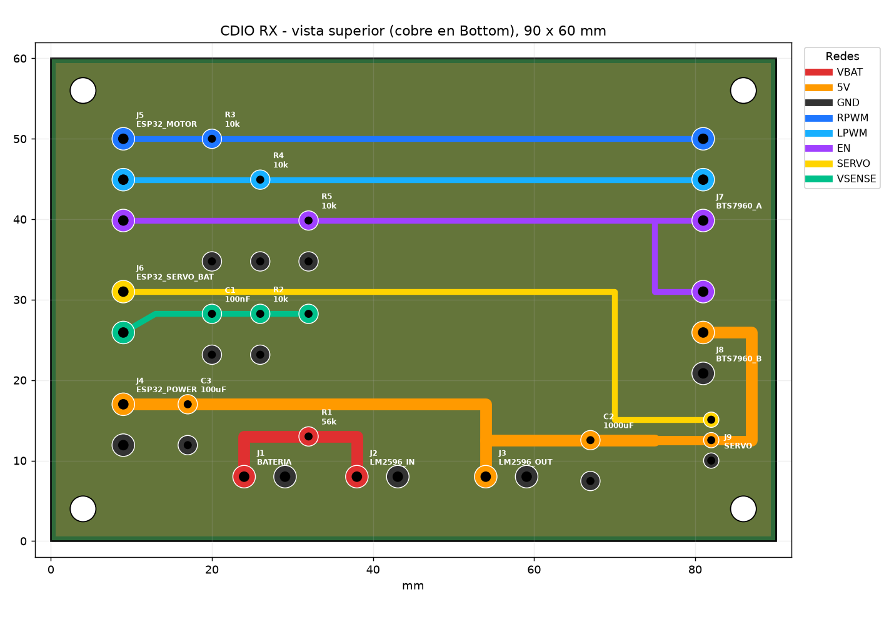

# PCB del auto (RX)

Placa de **90 × 60 mm, una capa (Bottom)** que funciona como hub de conexiones: todos los cables entran y salen por borneras de tornillo. Los módulos (ESP32 con su placa de borneras, LM2596 y BTS7960) quedan fuera de la PCB y se conectan con cables. En la PCB solo van las borneras, el conector del servo y los componentes pasivos.

## Archivos

| Archivo | Para qué |
| --- | --- |
| `cdio_rx.brd` | PCB ruteada. En Fusion: **Archivo > Abrir > Abrir desde mi equipo** |
| `cdio_rx.sch` | Esquemático del mismo circuito |
| `cdio_rx_fabricacion.zip` | **Entregable para el CNC**: Gerber del cobre Bottom, contorno, taladros (Excellon) y `LEEME.txt` |
| `fabricacion/` | Los mismos archivos del zip, sin comprimir |
| `generar_pcb.py` | Genera el `.sch` y el `.brd`. Si cambia una medida, se edita aquí y se ejecuta `python generar_pcb.py` |
| `exportar_gerber.py` | Genera los archivos de fabricación y el zip (`python exportar_gerber.py`, requiere shapely) |
| `vista_previa_pcb.png` | Imagen de referencia de la placa |

## Conexiones

| Bornera | Pin | Señal | Va hacia |
| --- | --- | --- | --- |
| J1 BATERIA | 1 / 2 | VBAT / GND | Batería 3S (+ / −), con cable delgado. El motor sigue con su cable grueso directo al BTS7960 |
| J2 LM2596_IN | 1 / 2 | VBAT / GND | Entrada del regulador (IN+ / IN−) |
| J3 LM2596_OUT | 1 / 2 | 5V / GND | Salida del regulador (OUT+ / OUT−), ajustada a 5,0 V |
| J4 ESP32_POWER | 1 / 2 | 5V / GND | Pines 5V y GND de la placa de borneras del ESP32 |
| J5 ESP32_MOTOR | 1 / 2 / 3 | RPWM / LPWM / EN | GPIO 25 / GPIO 26 / GPIO 27 |
| J6 ESP32_SERVO_BAT | 1 / 2 | SERVO / VSENSE | GPIO 13 / GPIO 34 |
| J7 BTS7960_A | de arriba a abajo | RPWM / LPWM / R_EN | Pines RPWM, LPWM y R_EN del BTS7960 |
| J8 BTS7960_B | de arriba a abajo | L_EN / VCC / GND | Pines L_EN, VCC y GND del BTS7960 |
| J9 SERVO | de abajo a arriba | GND / 5V / señal | Enchufe del servo: café / rojo / naranjo |

## Componentes

| Ref. | Valor | Función |
| --- | --- | --- |
| R1 | 56 kΩ | Divisor de batería (lado de VBAT) |
| R2 | 10 kΩ | Divisor de batería (lado de GND) |
| C1 | 100 nF cerámico | Filtra la lectura de batería en GPIO 34 |
| R3, R4, R5 | 10 kΩ | Pull-down de RPWM, LPWM y EN: el motor no se mueve mientras el ESP32 arranca |
| C2 | 1000 µF ≥ 10 V | Reserva para los picos del servo |
| C3 | 100 µF ≥ 10 V | Filtro del 5 V del ESP32 (patas abiertas a 5 mm) |
| J1–J4, J6 | Bornera KF301 de 2 polos, paso 5,08 mm | |
| J5, J7, J8 | Bornera KF301 de 3 polos, paso 5,08 mm | |
| J9 | Tira de 3 pines macho, 2,54 mm | |
| — | 4 tornillos M3 + separadores | Fijación al chasis (agujeros Ø3,2) |

R1, R3 y R4 van acostadas y su cuerpo pasa por encima de otras pistas: así se cruzan señales sin vías en una sola capa.

## Datos para el CNC

- Cobre solo en la capa **Bottom**, con los componentes del lado sin cobre.
- Pistas de 1,0 mm (señales) y 2,0 mm (potencia); separación mínima 0,6 mm.
- El resto del cobre es un plano de GND (aislamiento 0,8 mm), así que hay menos material que fresar.
- Brocas: 1,0 mm (resistencias, condensadores y conector del servo), 1,3 mm (borneras), 3,2 mm (fijación).
